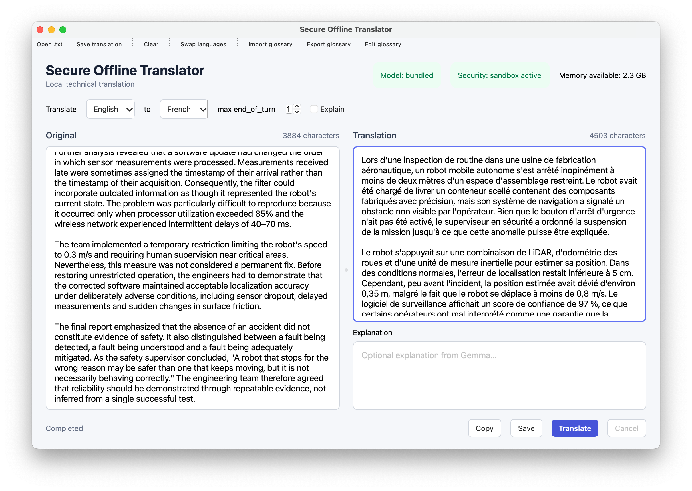

# Secure Offline Translator

### Built to translate. Not to transmit.

AI-powered technical translation, right on your Mac — with **no cloud inference and no network access granted to the sandboxed app**.

For documents that need to cross a language barrier, **not a network**.



## More than an offline promise

Many apps are called *offline* because they don't normally contact a server. Secure Offline Translator goes a step further: **its macOS App Sandbox is configured without permission to initiate network connections.**

That matters when you're working with engineering reports, internal specifications, or other material you would not want a translation tool to upload silently.

- **The operating system enforces the boundary.** The app is sandboxed without the outgoing or incoming network entitlements (`network.client` / `network.server`). Ordinary attempts by the sandboxed process to establish network connections are therefore restricted by macOS — not merely discouraged by application logic.
- **There's no cloud path to fall back to.** Inference runs in-process using `llama.cpp`, with no remote translation API, account, telemetry, HTTP server, or runtime model download.
- **Security has a visible status.** The interface reports whether its required App Sandbox entitlements are active. If that startup check fails, translation is disabled instead of continuing unprotected.

**The goal is to make accidental uploads and straightforward network-based data exfiltration substantially harder**, while keeping translation as simple as using any other desktop app.

> **A meaningful barrier, not a security certification.** The indicator verifies active sandbox and file-access entitlements; it does not independently prove that every possible exfiltration path is closed. Signed-build validation and adversarial network testing remain essential before using the app with highly sensitive data.

## Why I built it

Online translators are convenient — until the text is an internal report, a technical drawing's notes, or an engineering specification that should stay within your organization.

I wanted to explore whether modern AI translation could offer the same familiar desktop experience **without requiring users to trust an external service with their input**.

The result is a native macOS prototype that combines local language-model inference, a deliberately restricted network capability, and a clear, usable interface.

## Designed for everyday use

| Feature | Why it matters |
| --- | --- |
| **Side-by-side translation** | Review source and translated text in the same window. |
| **Fully local AI inference** | Text is processed on your Mac, not submitted to a cloud model. |
| **Sandbox status indicator** | See the result of the application's sandbox startup check. |
| **Technical glossary** | Guide translations toward consistent domain-specific terminology. |
| **Optional explanations** | Request context separately from the translated result. |
| **Open, copy & save** | Work with `.txt` files and export translations without an online account. |
| **Memory indicator** | Monitor available memory while using an on-device model. |

## What happens when you translate?

**Your text → on-device language model → translated text**

The model runs inside the native application, accelerated by Apple Metal. A dedicated background worker keeps the interface responsive; longer inputs are translated in smaller segments, and the loaded model is reused across requests.

The model is also checked against an approved **SHA-256 fingerprint** before loading, so a different or modified GGUF cannot be accepted silently.

<details>
<summary><strong>Under the hood — for the technically curious</strong></summary>

<br>

| Layer | Implementation |
| --- | --- |
| Desktop UI | C++20 · Qt 6 Widgets |
| Model inference | `llama.cpp` · Apple Metal |
| Reference model | TranslateGemma 4B (GGUF, Q4_K_M) |
| Network isolation | macOS App Sandbox, without client/server network entitlements |
| Runtime safeguard | Sandbox entitlement check; translation disabled on failure |
| Model integrity | Approved filename + SHA-256 verification |
| Hardening checks | Static checks for entitlements, selected network/process APIs, and bundle signature |
| Build | CMake · Ninja |

The application does not depend on Ollama, Docker, or an external inference server. The GGUF model is not committed to this repository. Using another approved model, such as TranslateGemma 12B, requires a matching model manifest and a rebuild; it is not presented here as the default configuration.

These controls reduce risk but do not make the app immune to all software vulnerabilities, indirect data-transfer mechanisms, or compromised dependencies. The source checks do not substitute for dynamic security testing.

</details>

## Build it yourself

**Status:** Working, developer-oriented prototype for macOS on Apple Silicon, not a notarized consumer release.

You'll need Homebrew, a compatible approved GGUF model, and a matching independently verified SHA-256 entry in the model manifest.

```bash
# Clone the source
git clone https://github.com/ViDem02/SecureOfflineTranslator.git
cd SecureOfflineTranslator

# Install build dependencies
brew install cmake ninja qtbase

# Fetch the pinned llama.cpp dependency
sh scripts/fetch-llama.sh

# Add your approved GGUF model before configuring
cp /path/to/translategemma-4b-it.Q4_K_M.gguf model/

# Build and launch
cmake -S . -B build -G Ninja -DCMAKE_PREFIX_PATH=/opt/homebrew
cmake --build build
open build/SecureTranslator.app
```

The dependency fetch occurs **during setup**. The translator itself is designed for offline runtime use and does not download a model or call a translation service.

Run the included checks:

```bash
ctest --test-dir build --output-on-failure
```

To inspect the application's signed entitlements on macOS:

```bash
codesign --verify --deep --strict build/SecureTranslator.app
codesign -d --entitlements :- build/SecureTranslator.app
```

For development and security details, see the [project requirements](Secure_Offline_Translator_Requisiti.md), [sandbox entitlements](entitlements/SecureTranslator.entitlements), and [hardening checks](tests/hardening_checks.cmake).

## Security and quality, without shortcuts

The aim is **privacy-conscious, controllable translation**, not an unqualified promise of zero leakage. An active sandbox, limited entitlements, model verification, and static checks provide concrete defenses — but do not prove that every indirect route out of a device is impossible.

Independent verification of signed builds, negative network tests, dependency review, and translation-quality evaluation are ongoing. Human review remains necessary for safety-critical, legal, or otherwise consequential translations.

---

**Built by [Victor Gabriele De Matteis](https://github.com/ViDem02)**  
Exploring practical AI, native software, and trustworthy engineering.
